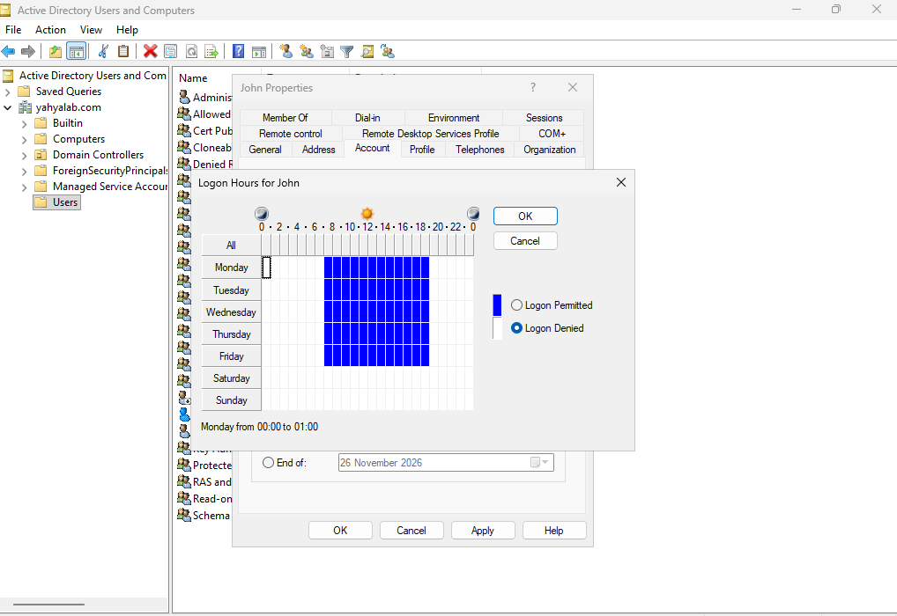
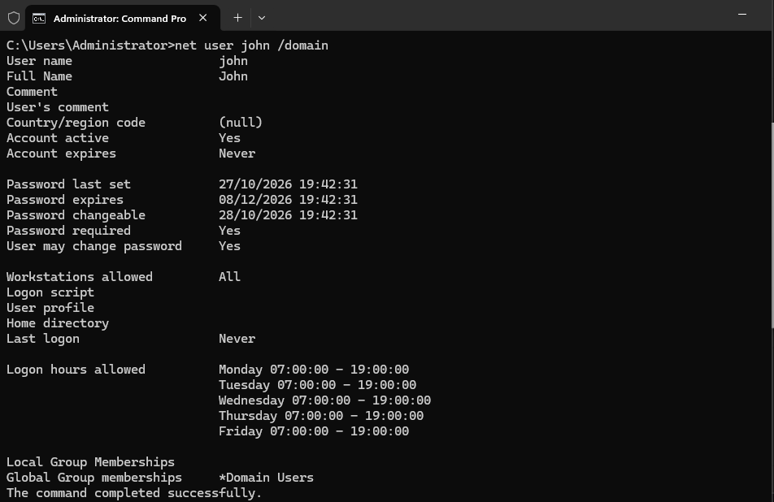
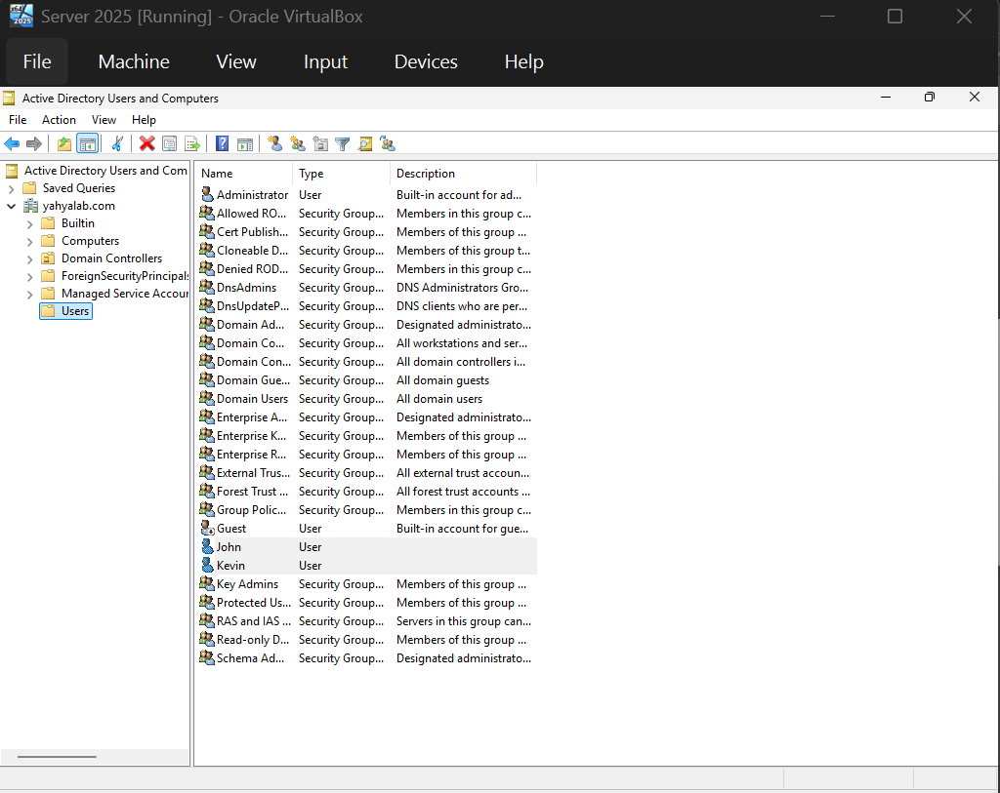

# Guest Additions and AD User Accounts

**Objective:** Install VirtualBox Guest Additions on the server, then
create the first user accounts in Active Directory.

## Steps
1. In the VirtualBox menu bar, selected Devices → Insert Guest Additions CD image.
2. Opened the CD drive inside the server and ran the installer.
3. Opened Active Directory Users and Computers from Server Manager → Tools.
4. Created a new user, `john`.
5. Opened john's properties to look through the available attributes, including basic user information.
6. Set john's logon hours so he can only log in Monday to Friday, 07:00 to 19:00.

7. Ran `net user john /domain` in Command Prompt to view the account's details from the command line, including the logon hours set in the previous step.

8. Created a second user, `kevin`. Both accounts now appear in the Users container.

## Tools / tech used
- VirtualBox Guest Additions
- Active Directory Users and Computers
- Command Prompt (`net user`)
- Windows Server 2025 Standard Evaluation

## What I learned
- Guest Additions is software installed inside the VM that improves how
  it works with the host. It adds features like display resizing, mouse
  integration, a shared clipboard and shared folders between the host
  laptop and the VM.
- User accounts in Active Directory have many attributes, and
  restrictions such as logon hours can be set per user.
- `net user <name> /domain` shows a domain account's details from the
  command line (account status, password dates, logon hours, group
  membership), which is useful for quick checks when troubleshooting.
