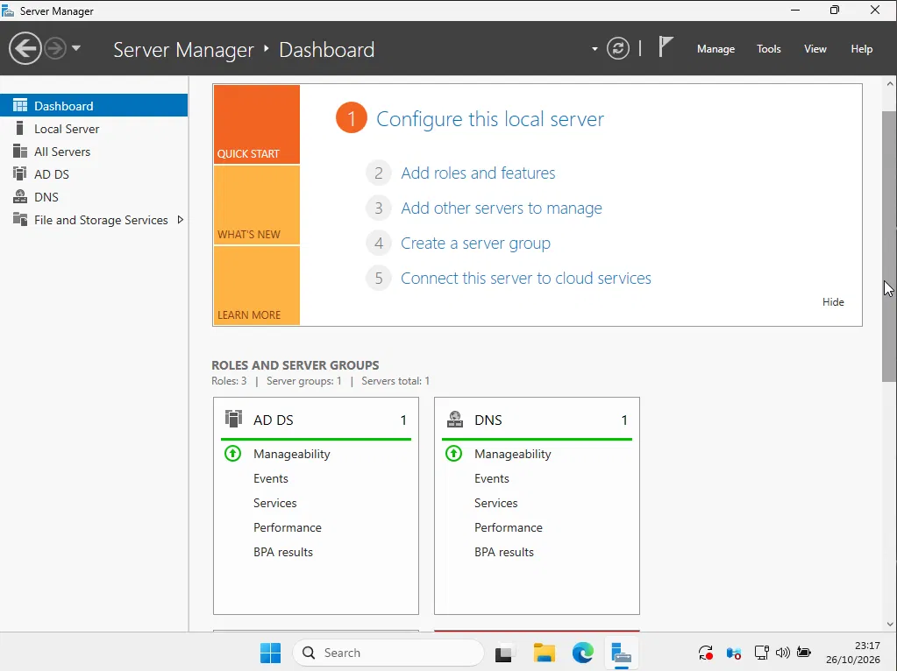
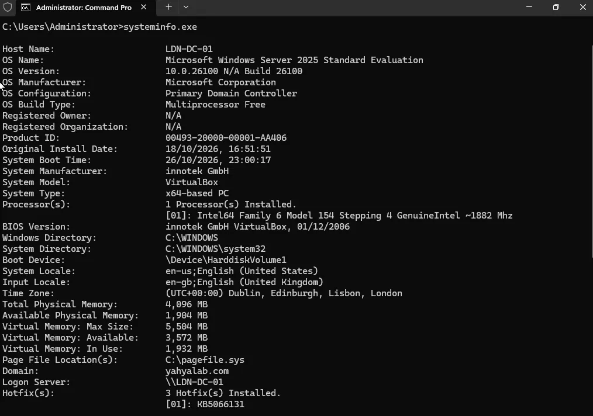

# Active Directory Setup

**Objective:** Install Active Directory Domain Services and promote the
server to a domain controller, creating the lab's domain.

## Steps
1. Renamed the server to `LDN-DC-01` (DC = domain controller).
2. In Server Manager, selected Manage → Add Roles and Features.
3. Installed the Active Directory Domain Services (AD DS) role with default features.
4. Selected "Promote this server to a domain controller".
5. Created a new forest and entered a root domain name.
6. Accepted the default settings for the rest of the wizard and installed. The installation took a while and the server restarted.
7. Verified the setup by running `systeminfo.exe` in Command Prompt, which displays the host name, OS version and domain.

## Tools / tech used
- Windows Server 2025 [edition]
- Server Manager
- Active Directory Domain Services (AD DS)
- Command Prompt (`systeminfo.exe`)

## What I learned
- AD DS stores information about users, computers and other objects on
  the network and makes it available to administrators.
- Domain controllers authenticate users, so one login (single sign-on)
  gives access to permitted resources anywhere on the network.
- A forest is the top-level container for a set of domains, and the root
  domain name is what identifies the network.
