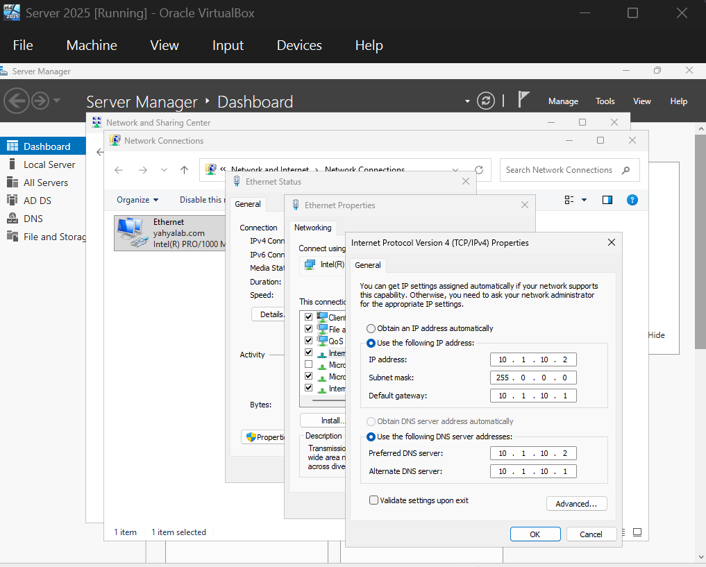
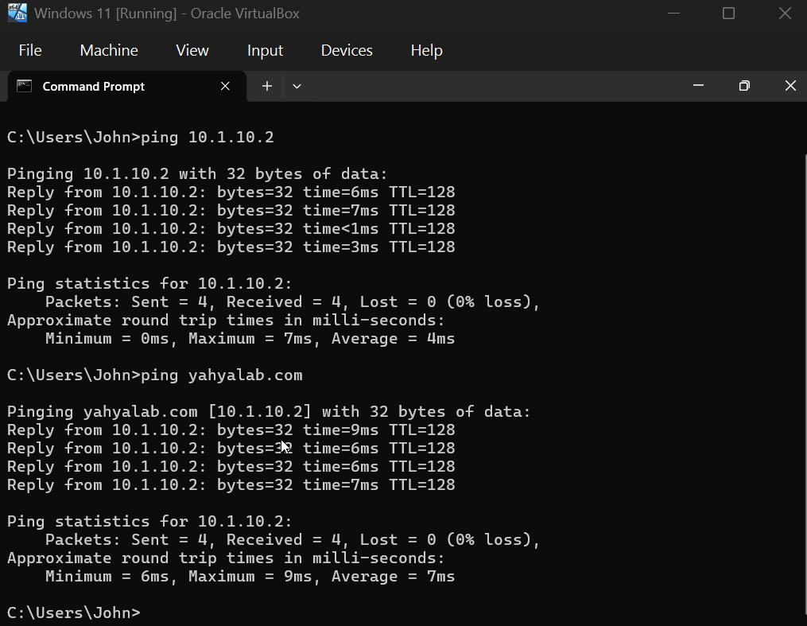
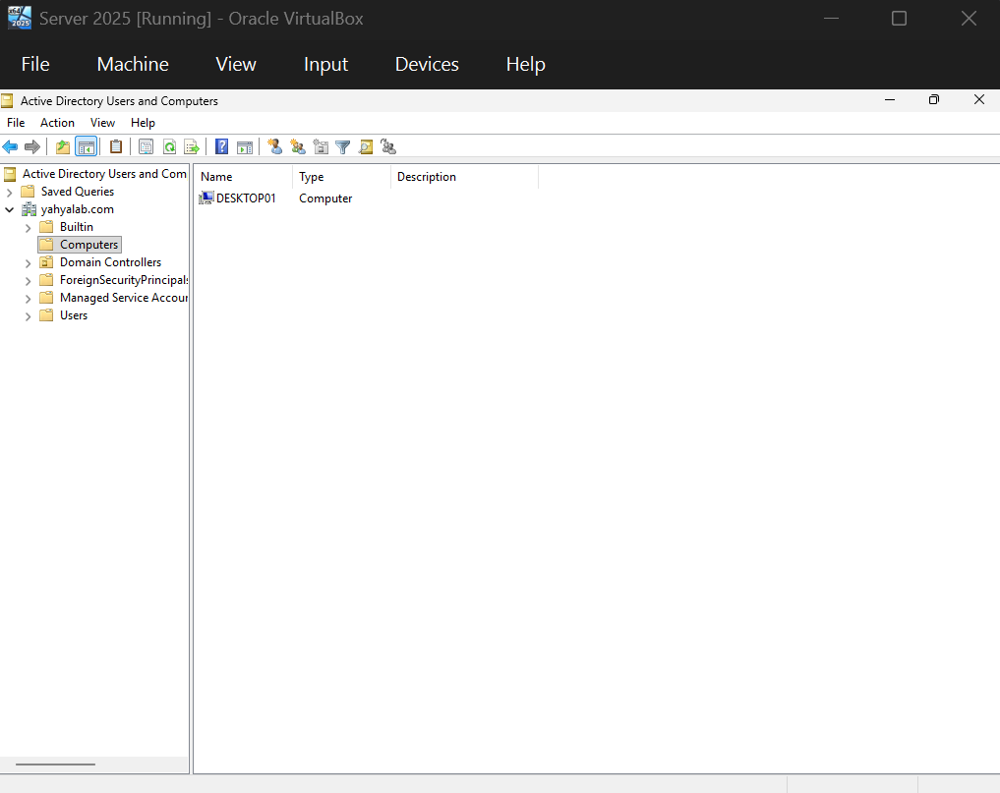

# Windows 11 Client and Domain Join

**Objective:** Build a Windows 11 client, put it on the same network as the domain controller, join it to the `yahyalab.com` domain, and manage the server remotely.

## Steps

### Building the Windows 11 VM
1. Created a Windows 11 VM in VirtualBox.
2. During setup, switched the network adapter to Host-only (Devices → Network). This stopped Windows setup from forcing a Microsoft account sign-in, so I could create a local user instead. It also keeps the lab on a private network shared only by the VMs and my laptop.
3. After installation, set a password for the local user in Computer Management → Users, so the account wasn't left with a blank password.
4. Renamed the PC to `DESKTOP01` so it is easy to identify in Active Directory.

### Assigning static IP addresses
5. On the server, switched the network adapter to Host-only as well, so both VMs sit on the same virtual network.
6. On each machine, set a static IPv4 address (Control Panel → Network and Internet → Network Connections → adapter Properties → IPv4). Static addresses mean the domain controller's address never changes. Both machines use the server as their preferred DNS server, because Active Directory relies on DNS to locate the domain controller.

| Setting | Server (LDN-DC-01) | Client (DESKTOP01) |
|---|---|---|
| IP address | 10.1.10.2 | 10.1.10.3 |
| Subnet mask | 255.0.0.0 | 255.0.0.0 |
| Default gateway | 10.1.10.1 | 10.1.10.1 |
| Preferred DNS | 10.1.10.2 | 10.1.10.2 |
| Alternate DNS | 10.1.10.1 | 10.1.10.1 |

### Testing connectivity
7. From the client, ran `ping 10.1.10.2` to confirm the two machines can reach each other, then `ping yahyalab.com` to confirm the domain name resolves to the server through DNS. I tested this before joining the domain because the join depends on both working.

### Joining the domain
8. On DESKTOP01, went to Settings → System → About → Domain or workgroup → Change, entered `yahyalab.com`, and supplied the credentials of an account allowed to join computers to the domain. Joining lets the machine authenticate users against the domain controller instead of relying only on local accounts.
9. Verified the join on the server: Active Directory Users and Computers → Computers shows DESKTOP01.

10. Signed in to DESKTOP01 as the domain user `kevin` to confirm the domain controller authenticates domain accounts. The first attempt failed (see Problems & fixes).

### Remote Desktop
11. On the server, enabled "Allow remote connections to this computer". This lets administrators manage the server over the network, as they would in a real environment where servers aren't usually accessed from the console.
12. From DESKTOP01, opened Remote Desktop Connection and connected to the server using the Administrator account.

## Tools / tech used
- Oracle VirtualBox (Host-only networking)
- Windows 11 (client) and Windows Server 2025 Standard Evaluation
- Active Directory Users and Computers
- Remote Desktop Connection
- Command Prompt (`ping`)

## Problems & fixes
- **Problem:** `kevin` could not sign in to DESKTOP01.
  **Cause:** Logon-hour restrictions I had set on the account earlier.
  **Fix:** Removed the restriction in Active Directory Users and Computers, then signed in successfully.

## What I learned
- Machines on the same subnet communicate directly, and servers should use static IPs so clients can always find them.
- A domain client must use the domain controller as its DNS server, because the domain join depends on DNS to find the DC.
- Pinging an IP address tests network connectivity, and pinging a name also tests DNS. If the IP works but the name fails, the problem is DNS.
- Logon-hour restrictions are enforced at domain sign-in, so they can cause "can't log in" tickets that look like password problems.
- Remote Desktop lets administrators manage servers without sitting at the machine.
