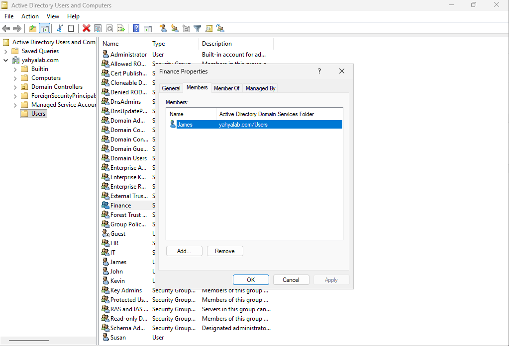
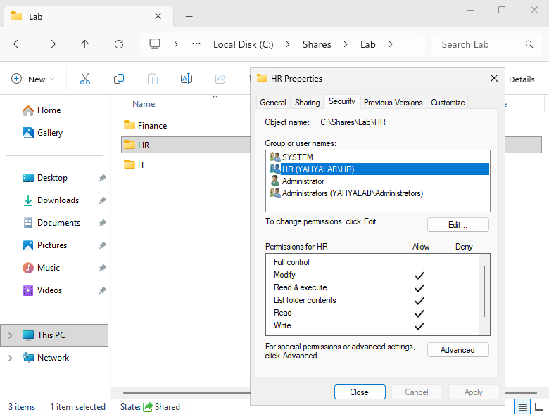
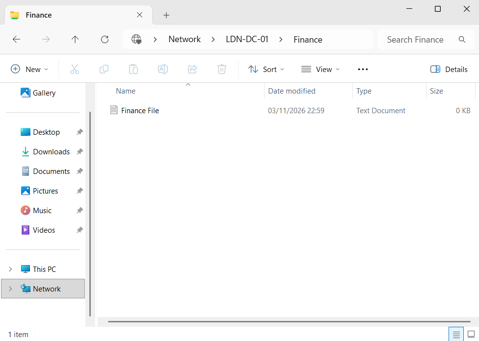
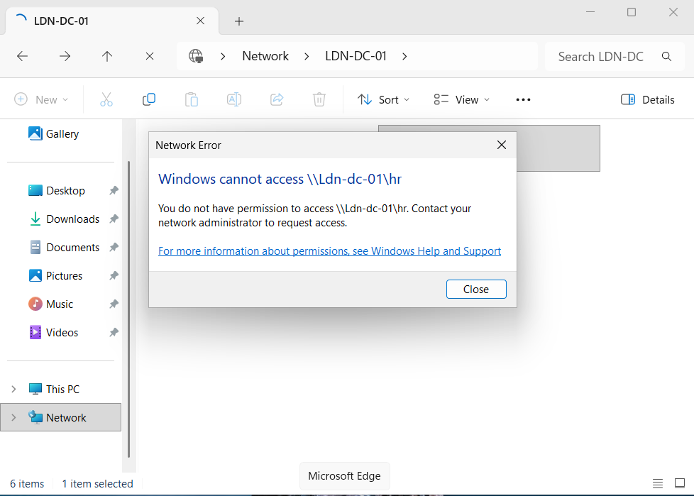
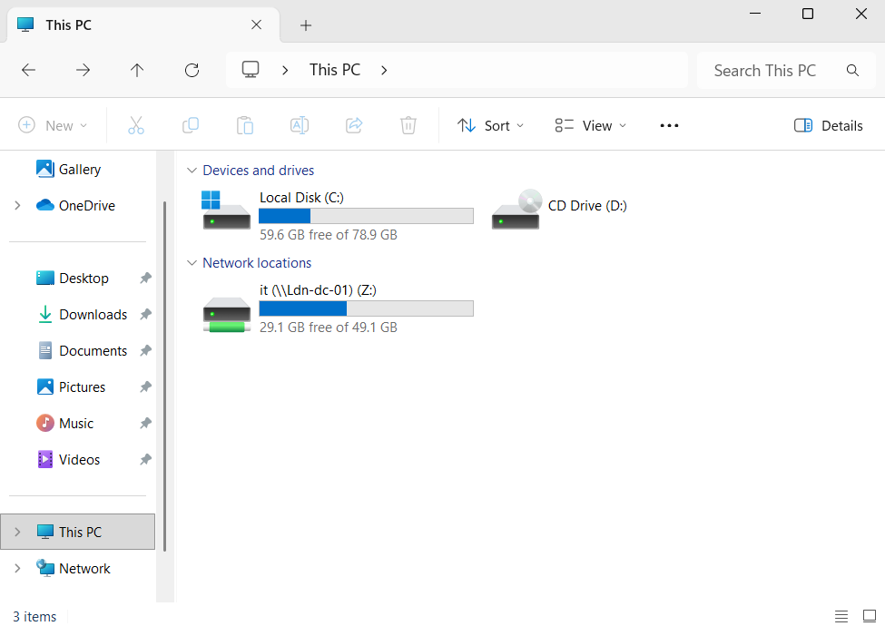

# Department Shares with Security Groups

**Objective:** Give each department access to its own folder through security groups instead of assigning permissions to individual users, and test it from the Windows 11 client.

## Steps

### Active Directory
1. In Active Directory Users and Computers, created three security groups (scope Global) under Users: `IT`, `Finance` and `HR`. Permissions are granted to each group once, rather than to every individual user.
2. Created two users, `james` (Finance) and `susan` (HR), with passwords that meet the domain password policy. The existing user `kevin` represents IT.
3. Added each user to the group for their department (group → Properties → Members → Add). From this point, adding someone to a group is all that's needed to give them access.

### Creating the share
4. In Server Manager → File and Storage Services → Shares, created a share named `LAB`. Disabled inheritance, converted inherited permissions to explicit ones, and removed everything except Administrators, so subfolders start as administrator-only.
5. Created three subfolders under `C:\Shares\Lab`: `IT`, `Finance` and `HR`.
6. For each subfolder:
   - Removed `Everyone` from Properties → Sharing → Advanced Sharing → Permissions.
   - On the Security tab, added the matching group with **Modify** rather than Full Control, so members can read and write files but cannot change the folder's permissions.
   - On the Sharing tab, shared the folder to the same group with Read/Write.

   Because `LAB` itself is administrator-only and each subfolder is shared separately, users connect to their folder directly through its own share path, for example `\\LDN-DC-01\Finance`.

### Testing
7. On DESKTOP01, signed in as `james` and browsed to `\\LDN-DC-01`. The Finance share opened and showed the test file I created.

8. As the same user, tried to open the HR share. Windows returned "You do not have permission to access", confirming that the Finance group has no access to HR.

9. Signed in as `kevin` and mapped the IT share as drive Z:, so it appears under This PC without typing the path each time.

## Tools / tech used
- Active Directory Users and Computers
- Server Manager (File and Storage Services)
- File Explorer sharing and NTFS permissions
- Windows Server 2025 Standard Evaluation and Windows 11 client (DESKTOP01)

## What I learned
- Permissions are given to security groups, not individuals, so access is managed by adding or removing users from a group.
- Groups get Modify rather than Full Control, so members can work with files without being able to change who has access.
- Group membership is read when a user signs in, so a user must sign out and back in after being added to a group.
- Other departments' shares were still listed on the network but returned Access denied when opened. Hiding them entirely would need access-based enumeration.
