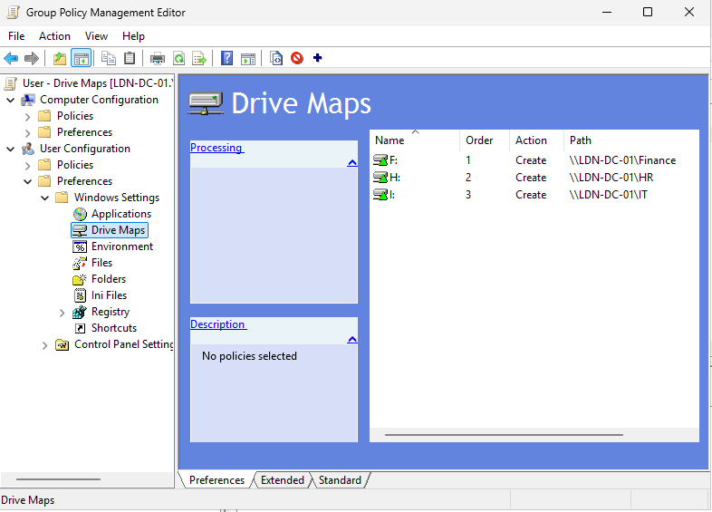
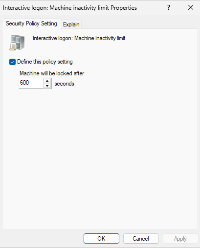
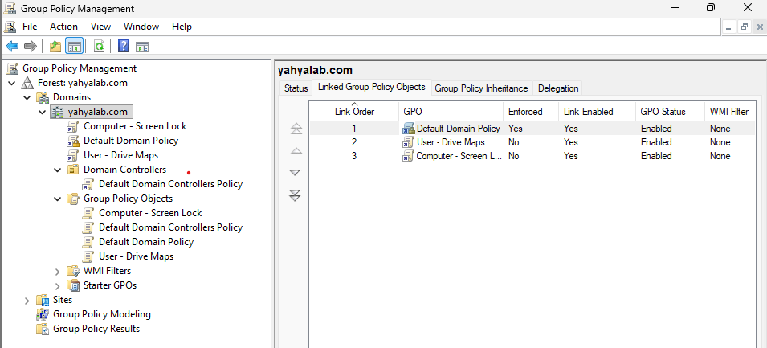
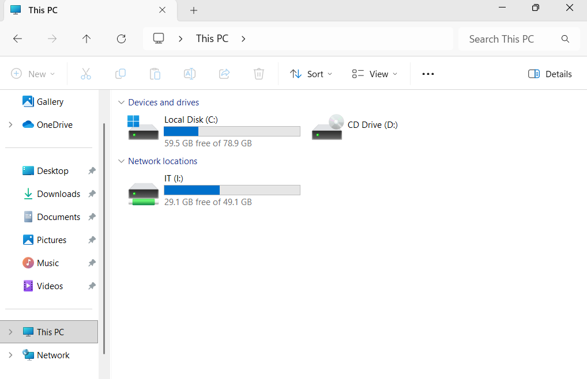

# Group Policy: Drive Maps and Screen Lock

**Objective:** Use Group Policy to map department drives automatically and lock idle machines, using separate GPOs instead of editing the Default Domain Policy.

## Steps
1. In Group Policy Management, created two new GPOs, `User - Drive Maps` and `Computer - Screen Lock`. Separate GPOs can be tested, scoped and removed independently, and the Default Domain Policy stays reserved for password and lockout rules.
2. In `User - Drive Maps`, went to User Configuration → Preferences → Windows Settings → Drive Maps and created a mapped drive for each department share, each with its own drive letter: `F:` for Finance, `H:` for HR and `I:` for IT.

3. On each drive map's Common tab, enabled item-level targeting by security group, so a drive only appears for members of the matching department group instead of for everyone.
4. In `Computer - Screen Lock`, went to Computer Configuration → Policies → Windows Settings → Security Settings → Local Policies → Security Options and set **Interactive logon: Machine inactivity limit** to 600 seconds (10 minutes), so an unattended machine locks itself.

5. Linked both GPOs to the `yahyalab.com` domain, so they apply to every user and computer in it.

6. On DESKTOP01, refreshed policy with `gpupdate /force` and signed in as `kevin`. Only the IT drive appeared as `I:`, and not `F:` or `H:`, which confirms the group targeting works.

7. Left DESKTOP01 idle for the inactivity period and confirmed the screen locked.

## Tools / tech used
- Group Policy Management and Group Policy Preferences
- Windows Server 2025 Standard Evaluation and Windows 11 client (DESKTOP01)

## Problems & fixes
- **Problem:** The screen lock policy did not take effect on DESKTOP01.
  **Cause:** I had created the GPO under Group Policy Objects but never linked it, so it applied to nothing.
  **Fix:** Linked it to the domain (right-click the domain → Link an Existing GPO), ran `gpupdate /force`, and retested. The screen then locked as expected.

## What I learned
- A GPO has no effect until it is linked, and where it is linked decides who it applies to: the domain applies it to everything, an OU only to the objects inside it.
- Using a separate GPO per purpose makes changes easier to troubleshoot and undo, and keeps the Default Domain Policy for account policies.
- Item-level targeting by security group lets one drive-map policy give each department its own drive, reusing the same groups that control folder permissions. The drive map doesn't grant access, so the share and NTFS permissions still decide who can open it.
- User settings apply when the user signs in, so a sign-out and sign-in is needed to see them, while `gpupdate /force` refreshes policy without waiting.
