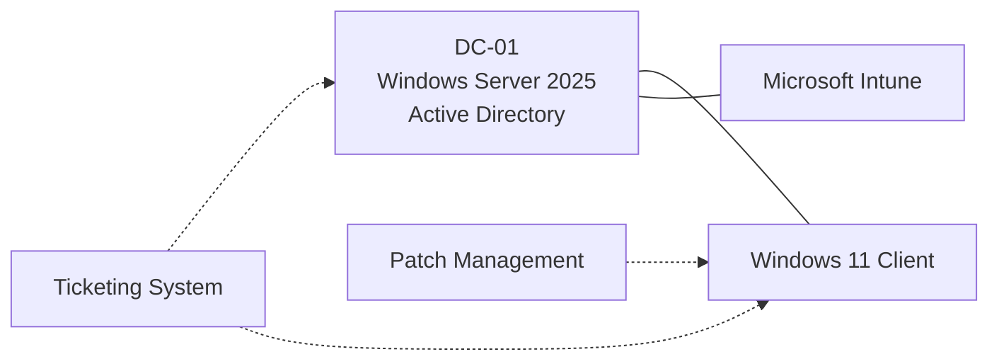

# Helpdesk Home-Lab

A virtualized enterprise environment built to practise core helpdesk and desktop support work: user and device administration, endpoint management, patching, and incident handling.

## Architecture



## What I Built

- **Active Directory:** configured users, groups, and OUs on a Windows Server 2025 domain controller and joined a Windows 11 client to the domain
- **Intune:** enrolled the client and applied compliance policies and app deployment
- **Patch management:** deployed and verified updates on the client using [tool]
- **Ticketing:** logged and resolved simulated incidents in [tool], documented in [`tickets/`](tickets/)

## Skills Demonstrated

Active Directory administration, Intune/MDM, patch management, ticket documentation, troubleshooting methodology

## Structure

```
├── docs/       # step-by-step build notes
├── tickets/    # incident write-ups
└── images/     # screenshots
```
