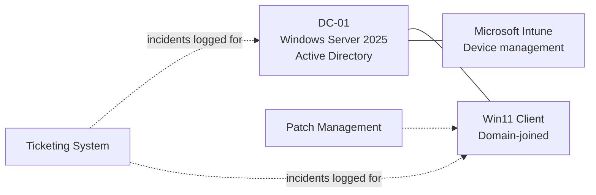

# Helpdesk-HomeLab

# IT Helpdesk Lab

A virtualized enterprise environment built to practise the day-to-day work of an IT helpdesk / desktop support role: user and device administration, endpoint management, patching, and incident handling through a ticketing system.

> **Status:** In progress. See the [Progress](#progress) table for what is complete.

## Credit

The initial build is based on the [KevTech IT Support](https://www.youtube.com/@KevTechITSupport) helpdesk lab video series. The troubleshooting scenarios, tickets, scripts, and written documentation in this repository are my own work.

## Lab Architecture



## Components

| Component | Purpose | What I practise |
|---|---|---|
| **DC-01** (Windows Server 2025) | Domain controller running Active Directory | Users, groups, OUs, password resets, account lockouts, domain join |
| **Windows 11 client** | The endpoint being supported | Domain join, user profiles, troubleshooting |
| **Microsoft Intune** | Cloud-based device management | Enrollment, compliance policies, app deployment |
| **Patch management** | Keeping systems updated | Update deployment, verification, reporting |
| **Ticketing system** | Logging and resolving incidents | Ticket documentation, prioritisation, resolution notes |

## Tools and Technologies

- VirtualBox
- Windows Server 2025
- Windows 11
- Active Directory Domain Services
- Microsoft Intune
- *(Patch management tool: add once chosen)*
- *(Ticketing system: add once chosen)*
- PowerShell *(add if used)*

## Progress

| Part | Topic | Status | Notes |
|---|---|---|---|
| 1 | VirtualBox, Windows 11 ISO, Windows Server 2025 install | Done | [docs/01-virtualbox-and-server-setup.md](docs/01-virtualbox-and-server-setup.md) |
| 2 | *(add)* | Not started | |
| 3 | *(add)* | Not started | |
| 4 | *(add)* | Not started | |
| 5 | *(add)* | Not started | |
| 6 | *(add)* | Not started | |
| 7 | *(add)* | Not started | |
| 8 | *(add)* | Not started | |
| 9 | *(add)* | Not started | |
| 10 | *(add)* | Not started | |

## Beyond the Tutorial

Work I am adding that is not part of the original series:

- [ ] Simulated incident tickets (account lockout, GPO misconfiguration, domain connectivity issue, failed Intune enrollment, etc.)
- [ ] Group Policy configuration
- [ ] File share with permission groups
- [ ] PowerShell scripts (e.g. bulk user creation, inactive account report)
- [ ] User onboarding and offboarding procedure

## Incident Tickets

Each ticket documents the symptoms, troubleshooting steps, root cause, and resolution.

| Ticket | Issue | Status |
|---|---|---|
| *(add as completed)* | | |

## Repository Structure

```
helpdesk-lab/
├── README.md
├── docs/          # step-by-step notes, one per video
├── tickets/       # simulated incident write-ups
├── scripts/       # PowerShell and other scripts
└── images/        # screenshots and architecture diagram
```

## What I Learned

*Write this last, in your own words: 3 to 5 sentences on what was difficult, what broke, and what you would do differently.*

## Next Steps

*Optional: e.g. add monitoring, explore Entra ID / hybrid join in more depth, extend with security hardening.*
